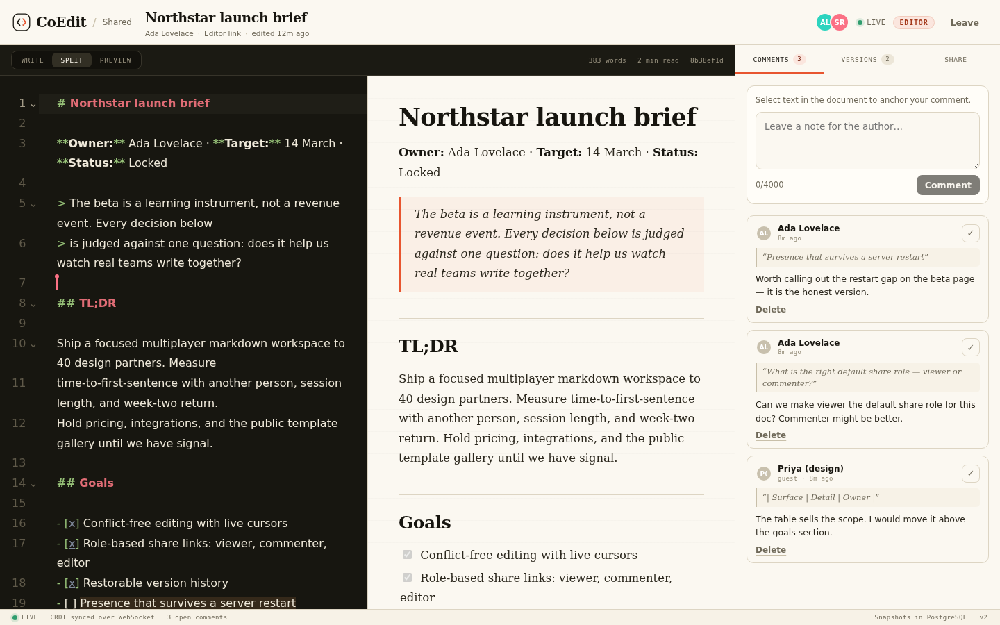

# CoEdit

**A real-time collaborative markdown workspace.** Conflict-free CRDT editing over
WebSockets, live presence and cursors, role-scoped share links, and restorable version
history — built with TypeScript, Next.js, Node.js, Yjs, PostgreSQL and Redis.



## What it does

- **Multiplayer by default.** Every keystroke is a Yjs update. Edits merge without a
  central lock, cursors follow the person typing, and a reconnecting client closes the
  gap with a state-vector exchange instead of a full reload.
- **Permission is enforced on the socket, not in the UI.** A viewer receives the
  document and presence but the server drops any update frame they send. Commenters can
  annotate without touching the text. Editor links can write.
- **Share links with real roles.** `viewer`, `commenter`, and `editor` capabilities are
  minted as 256-bit tokens (only their SHA-256 hashes are stored) with optional expiry
  and revocation.
- **Version history that is actually restorable.** Append-only updates are compacted by
  full-state snapshots. Restoring a snapshot rewrites the live CRDT as a normal
  transaction — everyone converges, and the pre-restore state is saved first.
- **Anchored comments.** Select text, leave a note, resolve the thread. Comments survive
  edits because their quotes are re-located in the current document.
- **A workspace around the editor.** Account documents, recent activity, share-link
  management, automatic session snapshots, and a live markdown preview.

## Stack

| Layer | Technology |
| --- | --- |
| Web | Next.js 16 (App Router, RSC), React 19, hand-written CSS |
| Editor | CodeMirror 6, `y-codemirror.next`, Yjs CRDT |
| Sync server | Node.js 22, Express 5, `ws`, `y-protocols` |
| Data | PostgreSQL 18 (16+ compatible), raw SQL + migration runner |
| Fan-out | Redis pub/sub (optional; in-process bus fallback) |
| Auth | HS256 access tokens, scrypt passwords, single-use WebSocket tickets |
| Deploy | Docker multi-stage images, Docker Compose |

## Architecture

```
 Browser ── httpOnly cookie ──► Next.js BFF ── Bearer / share token ──► Node API
    │                               │                                    │
    │      binary Yjs frames         │                           PostgreSQL
    └──────── WebSocket ─────────────┴──────────► Yjs room ────── documents
                 (ticket)                          │             updates
                                                   │             snapshots
                                                   └── Redis pub/sub (presence,
                                                       updates, control hints)
```

The browser never holds an API token: login sets an httpOnly cookie and all REST calls
are proxied by Next.js. The WebSocket uses a different credential: a **90-second,
single-use ticket** bound to one document and one role, minted by the API and consumed
on the first upgrade.

## Repository layout

```
coedit/
├── apps/
│   ├── server/                 REST API + collaborative WebSocket server
│   │   ├── src/realtime/       gateway, Room (Yjs), pub/sub, ticket store
│   │   ├── src/routes/         auth, documents, shares, comments, snapshots, tickets
│   │   ├── src/repositories/   SQL data access
│   │   ├── src/db/migrations/  versioned schema
│   │   └── tests/              integration tests (real DB + real sockets)
│   └── web/                    Next.js app
│       └── src/
│           ├── app/            landing, auth, workspace, editor, share pages
│           ├── components/     editor workspace, panels, presence
│           └── lib/            BFF client, collab socket, formatting
├── packages/shared/            roles, DTOs, wire protocol constants
├── scripts/                    local database helper, verification scripts
├── docs/                       API notes, architecture, screenshots
├── docker-compose.yml
├── Dockerfile.server
└── Dockerfile.web
```

## Quick start (local, no Docker)

Prerequisites: Node 20.9+, PostgreSQL server binaries (`initdb`, `pg_ctl`, `createdb`).

```bash
npm install
npm run db:start          # throwaway PostgreSQL cluster on 127.0.0.1:55433
npm run seed              # demo accounts, documents, comments and share links
npm run dev               # API :8787 + web :3000
```

Open <http://localhost:3000>.

Redis is optional locally. Without `REDIS_URL`, the server uses an in-process pub/sub bus
and an in-memory ticket-replay guard — fully functional for a single instance.

### Demo data

| Account | Password | Role |
| --- | --- | --- |
| `demo@coedit.dev` | `Password123!` | Owner of the demo documents |
| `sam@coedit.dev` | `Password123!` | Owner of the RFC document |

The seed prints three stable share links for **Northstar launch brief** — viewer,
commenter and editor — for example:

```text
http://localhost:3000/s/demoViewerLink4f8a2c6e9b1d3f5a7c9e2b4d6f8a1c3e
http://localhost:3000/s/demoCommenterLink7b2d4f6a8c1e3b5d7f9a2c4e6b8d1f3a
http://localhost:3000/s/demoEditorLink9d1f3b5a7c2e4f6b8d1a3c5e7f9b2d4a
```

Open the editor link in two browser profiles, or use the viewer link to watch without an
account.

### Try the multiplayer flow

1. Sign in as the demo account and open **Northstar launch brief**.
2. Open **Share**, create a viewer link, and paste it into a private window.
3. Type in the original tab: the guest sees the text and the cursor move in real time.
4. Open **Versions** → **Preview** on an older snapshot → **Restore**. Both tabs converge.

## Quick start (Docker)

```bash
docker compose up --build -d
docker compose --profile seed run --rm seed     # demo data
```

| Service | URL |
| --- | --- |
| Web | <http://localhost:3000> |
| Collaboration API | <http://localhost:8787/api/health> |
| PostgreSQL | `localhost:55433` |
| Redis | `localhost:6379` |

Set a strong `JWT_SECRET` in the environment (or `.env`) before exposing anything.

## Roles

| Capability | Owner (account) | Editor link | Commenter link | Viewer link |
| --- | :---: | :---: | :---: | :---: |
| Read document + presence | ✓ | ✓ | ✓ | ✓ |
| Write CRDT updates | ✓ | ✓ | — | — |
| Comment | ✓ | ✓ | ✓ | — |
| Rename title | ✓ | ✓ | — | — |
| Save / restore versions | ✓ | ✓ | — | — |
| Create / revoke share links | ✓ | — | — | — |
| Delete document | ✓ | — | — | — |

The modal for a guest only collects a display name. Permissions come from the server
ticket, never from client-provided presence data.

## Sync protocol

Each binary frame starts with a message type:

| Byte | Meaning |
| --- | --- |
| `0` | `y-protocols` sync (step 1 / step 2 / update) |
| `1` | awareness update (presence, cursor, selection) |

Text frames carry JSON control hints: `ready`, `error` (`read-only`), `comments-changed`,
`snapshots-changed`, `title-changed`.

Connection lifecycle:

1. Client requests `POST /api/documents/:id/ws-ticket` through the BFF.
2. API resolves the caller (account or share token), signs a ticket with document, role,
   display name and colour, and records its `jti`.
3. Server verifies the ticket, consumes the `jti`, loads the room, and sends `ready` plus
   a sync step 1.
4. Client replies with its step 1; both sides exchange step 2. Awareness states replay so
   late joiners see who is already there.
5. Reconnect repeats the flow with a fresh ticket. The local CRDT keeps unacknowledged
   edits and the state-vector exchange merges them back.

Read-only roles still receive sync and awareness frames. The server drops
`sync step 2` / `update` messages from them and returns a `read-only` control error.

## Persistence model

- **`doc_updates`** — append-only Yjs updates with a per-document sequence and author.
- **`snapshots`** — encoded CRDT state, plain markdown content, label, kind
  (`auto`, `manual`, `pre-restore`), author and timestamp.
- **Load** — latest snapshot + every update after it. Yjs updates are idempotent, so
  replay is safe even when a snapshot overlaps the log.
- **Snapshots** are created on a timer/update threshold, at session end when content
  changed, manually, and before a restore.
- **Restore** — writes a `pre-restore` snapshot, then rewrites the live `Y.Text` inside a
  transaction. That emits a normal update, so every connected peer merges it.

## Tests

```bash
npm test                  # 7 integration tests against PostgreSQL + real WebSockets
npm run typecheck         # shared, server and web
npm run build             # production builds
node scripts/verify-ui.mjs        # optional: two real Chromium sessions
node scripts/capture-screenshots.mjs
```

The integration suite covers:

1. Two editors converge in both directions and updates are persisted.
2. A viewer's update is rejected and the owner's state is untouched.
3. A commenter can post comments but cannot edit or mint share links.
4. Ticket replay is rejected; non-members cannot obtain a ticket.
5. Revoked share links stop issuing tickets and return `410` on the public context.
6. Snapshot restore converges for every peer and keeps a `pre-restore` version.
7. Spoofed presence names are replaced by the server-issued identity.

The browser script opens two independent sessions on the same editor link, types in one,
asserts convergence and presence in the other, posts a comment, and fails on any page or
console error. Screenshots are captured from the seeded demo without modifying content.

## Configuration

Copy `.env.example` to `.env`. The server reads root `.env` automatically; Next.js reads
`API_URL` and `WS_URL` from the process environment (defaults work locally).

| Variable | Default | Purpose |
| --- | --- | --- |
| `DATABASE_URL` | local cluster on `:55433` | PostgreSQL connection |
| `PORT` | `8787` | API/socket port |
| `APP_ORIGINS` | `http://localhost:3000` | Allowed WebSocket origins (comma-separated) |
| `JWT_SECRET` | dev-only value | Access tokens + tickets; **change in production** |
| `REDIS_URL` | unset | Enables Redis pub/sub and shared replay guard |
| `WS_TICKET_TTL_SECONDS` | `90` | Ticket lifetime |
| `SNAPSHOT_INTERVAL_MS` | `60000` | Auto-snapshot cadence |
| `SNAPSHOT_MAX_UPDATES` | `200` | Auto-snapshot update threshold |
| `ROOM_IDLE_MS` | `45000` | Room unload delay after the last client |
| `API_URL` (web) | `http://127.0.0.1:8787` | Server-side BFF target |
| `WS_URL` (web) | `ws://localhost:8787/ws` | Browser WebSocket endpoint |

## Security notes

- Passwords use scrypt (`N=16384, r=8, p=1`) with per-user salts and constant-time compare.
- Access tokens are HS256 JWTs in httpOnly, SameSite=Lax cookies. The browser never sees
  the collaboration API directly.
- WebSocket tickets are short-lived, audience-bound, and single-use (`jti`; Redis `SET NX`
  when available).
- Share tokens are 32 random bytes, base64url-encoded, stored only as SHA-256 hashes.
- The server overwrites presence identity from the ticket, so a viewer cannot appear as
  the owner or spoof a display name to other peers.
- WebSocket upgrades check `Origin`. REST is server-to-server; no CORS surface is opened.
- Auth, share-context, and comment endpoints are rate limited in process.
- Markdown preview renders with `react-markdown` and no raw HTML, so document content
  cannot inject markup.

## Known limitations / next steps

- **Update log compaction** is an operational step, not automatic. The load path replays
  every update, which is correct but grows linearly. A state-vector watermark job is the
  next improvement.
- **Revoking a link** immediately blocks new tickets and API calls, but an already-open
  socket stays connected until it disconnects. Add periodic revalidation for stricter
  revocation semantics.
- **Offline reloads** start from the server copy; there is no IndexedDB cache yet.
- **Restore rewrites text**, so CRDT formatting marks from the snapshot are not replayed.
  The markdown content and pre-restore state are preserved.
- **Redis fan-out** is implemented and used whenever `REDIS_URL` is set; the local demo
  and CI run in in-memory mode. Without Redis, the replay guard is per instance.
- Document **titles are metadata** (PostgreSQL), not CRDT content. Renames broadcast a
  control hint but do not merge conflict-free.
